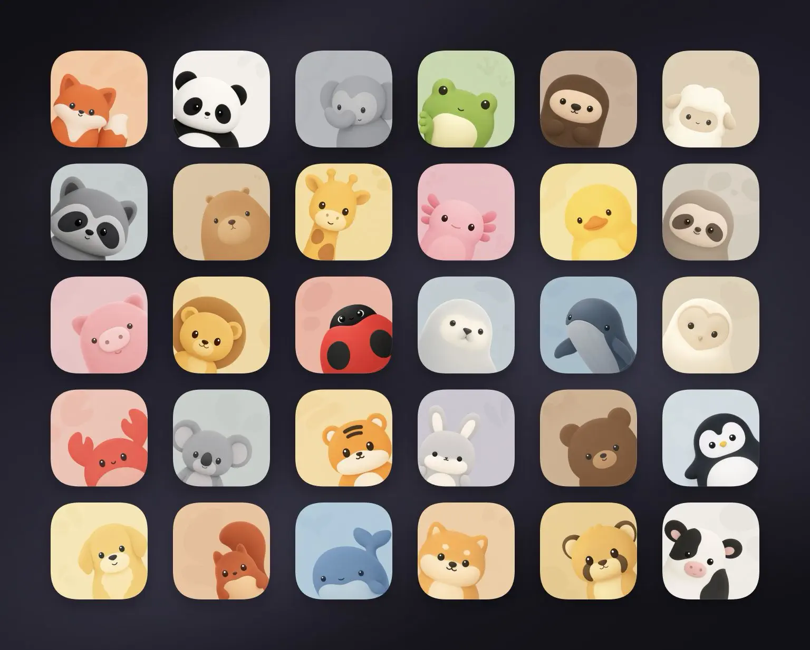

# IP as Logo

`ip-as-logo` is a compact Agent Skill for generating extremely simple, cute character IPs that stay recognizable at `32 × 32`. It prioritizes lovable baby-like appeal, bold rounded silhouettes, a locked natural color identity, and a dominant lower-corner composition.

It follows the open Agent Skills format and is designed to work with any compatible AI agent, rather than being tied to a specific agent product.



This is an independently maintained fork. It is not affiliated with or operated by the upstream project's website or download service.

## What differs in this fork

- Replaces the upstream's fixed semantic-color approach with a **subject-derived color system**: an animal or object's recognizable natural palette is locked first, then mapped to Bright Tonal or Soft Neutral Pastel.
- Derives backgrounds from that same subject family, using value and saturation for separation instead of an unrelated or complementary brand palette.
- Adds rules for sparse, same-source watermark marks and freezes each subject's color contract across variants.
- Uses this fork's own installation source: `okooo5km/ip-as-logo-skill`.
- Includes this fork's showcase preview. The upstream website and its downloadable-logo catalog are not part of this repository.

## What it guides

- One dominant silhouette built from roughly 4–7 large basic shapes
- A natural or intrinsic color lock before any product-theme interpretation
- At most two broad internal color regions, plus only the small natural accent or neutral needed for recognition
- Three proposed directions followed by six independently generated candidates after user approval
- Familiar, broadly appealing animals as the default open-ended subject; objects, machines, fantasy artifacts, and obscure creatures require a clear product reason
- Bright Tonal or Soft Neutral Pastel mapping that keeps the subject's recognizable hue family intact
- A clean, same-family tonal background derived from the mapped subject rather than an independent or complementary product color
- One to three optional, nearly invisible tone-on-tone background marks derived from the subject itself
- Thick, rounded forms without sharp or fragile details
- A large, visually dominant IP emerging flexibly from the lower-left or lower-right, without prescribing a fixed crop
- A balanced default six-image split: three lower-left and three lower-right
- Extreme simplification, cute baby-like appeal, and removal of nonessential lines and details
- One named solid background color filling the square, without image-mode language in the generation prompt
- Image-only generation prompts that never reveal logo, brand-mark, app-icon, or icon-asset use
- One-pass batch generation that preserves and delivers every returned image without filtering or automatic retries

## Install

Install the complete skill with the Agent Skills CLI:

```bash
npx skills add okooo5km/ip-as-logo-skill
```

The installer detects the repository's root `SKILL.md`, lets you choose a supported coding agent, and installs the complete `ip-as-logo` directory, including its supporting assets. Use `--global` for a personal installation available across projects:

```bash
npx skills add okooo5km/ip-as-logo-skill --global
```

## Agent compatibility

Supported agents include **Codex, Coze, Doubao, YouMind, Manus, Gemini Apps, and Replit Agent**. The agent must have a top-tier image model: preferably GPT Image 2, or Seedance 5.0 Pro, Nano Banana Pro (Gemini Image Pro), or Nano Banana 2 (Gemini Image Flash). If none is available, enable a suitable tool or provide its API key. The skill never falls back to SVG; another image model may be used only with explicit user consent, with no guarantee of equivalent quality.

## Use

Ask your AI agent for an IP mascot image, for example:

```text
Create a very simple, cute rounded ghost IP character on a solid deep navy background.
```

The skill does not ask for a color-mode choice by default. It first locks each animal's recognizable dominant family, broad markings, and essential small accents, then maps that identity into either **Bright Tonal** or **Soft Neutral Pastel**. The background always comes from that mapped family, using separation in value and saturation rather than a competing product palette. A two-color image is generated only when the user explicitly requests it.

When the user already names an IP subject, the skill proposes three controlled design treatments of that subject. When the subject is open, it proposes familiar animal mascots first and ties each to a product attribute or brand promise. In open-ended batches, 95–100% of candidates should be familiar animals; non-animal subjects are limited to a small minority with a direct product connection, never used merely to manufacture novelty.

Large batches create variety through species, breed, defining silhouette, broad natural markings, expression, lower-left versus lower-right emergence, and crop. The aim is a crisp, immediately readable character rather than illustrative novelty. Clocks, locks, industrial tools, measuring instruments, vehicles, abstract machines, fantasy artifacts, and obscure creatures are not default company mascots.

If the skill runs inside a product repository, it inspects relevant read-only context before asking questions. If product context is insufficient, it asks one consolidated round of background questions. Once context is sufficient, it always presents three concise directions and proposes generating six independent images. It proceeds after the user agrees, or immediately when the user has already explicitly authorized six outputs.

When the user accepts all three directions, the default batch contains two variants per direction: `A1`, `A2`, `B1`, `B2`, `C1`, and `C2`. The first variant of each direction emerges from the lower-left and the second from the lower-right. When the user selects one direction, odd-numbered variants use the lower-left and even-numbered variants use the lower-right. This guarantees a three-left, three-right default split. If the user rejects the proposed quantity or distribution, their replacement instructions take precedence.

Every default candidate emerges from the lower-left or lower-right rather than the center or bottom-center and fills roughly 85–95% of the square so the IP remains visually dominant. Bottom or side cropping may strengthen the corner emergence, but the Skill does not prescribe exact edge contact or a fixed crop.

Compatible agents may generate the six candidates in parallel with subagents up to the runtime's available concurrency, using additional waves when needed. The skill checks for a supported top-tier image model before generation and asks the user to enable one or provide its API key when necessary. Every result is a separate full-resolution square asset, never a six-image contact sheet.

When the user does not supply a palette, the skill derives a slightly lighter, darker, or less-saturated background from the subject's mapped dominant family. Pale subjects receive a moderately deeper tonal field; high-contrast neutral subjects receive a high-key neutral carrying only a faint borrowed tint. The generation prompt names the intended solid background color directly and avoids terms such as `opaque`, `alpha`, or `transparency` that may distract the image model from the desired visual result.

Although the project is named `ip-as-logo`, the prompt sent to the image generator describes only the requested square character image. It never calls the result a logo, brand mark, app icon, or icon asset, and it does not prepend use-case metadata that reveals those purposes.

Generation is intentionally treated as a creative draw. Each requested candidate is generated once and delivered as returned. The skill does not inspect transparency, block outputs, classify candidates as compliant or non-compliant, or automatically retry results because of their background, colors, composition, gradients, shading, or dimensionality. Users can explicitly request another draw or a refinement after reviewing the batch.

## Repository structure

```text
SKILL.md
assets/ip-as-logo-wall.webp
README.md
LICENSE
```

The skill itself intentionally consists of a single instruction document. The repository also includes the showcase image above, but no scripts, style references, or generation dependencies.

## Model behavior

Image-generation models are stochastic and may interpret individual constraints differently. The skill preserves and returns every result without validation gates, transparency checks, automatic rejection, automatic retry, or silent repair.

## License

MIT

## Fork and attribution

This repository is a fork of [s1dashu/ip-as-logo-skill](https://github.com/s1dashu/ip-as-logo-skill). The upstream project's website is [ipaslogo.com](https://ipaslogo.com). The original work is copyright © 2026 s1dashu and remains available under the MIT License.

Fork-specific changes are copyright © 2026 okooo5km (十里), including the subject-derived color system, customized installation guidance, and showcase preview. See [NOTICE](NOTICE) for the complete attribution record.
